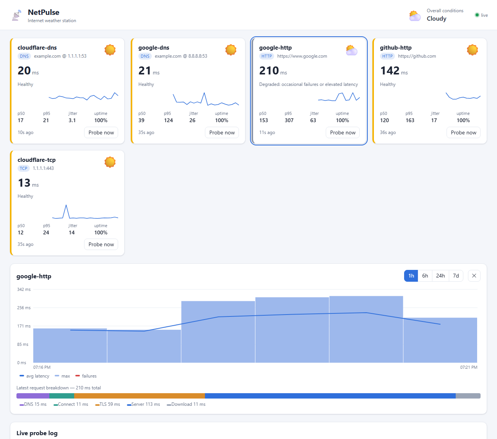

# NetPulse


**A real-time internet weather station built with Go.** NetPulse probes DNS resolvers, websites and TCP endpoints on a schedule. It stores every result in SQLite and reports overall conditions as weather: ☀️ sunny, ⛅ cloudy, 🌧️ rainy or ⛈️ stormy. A live dashboard and a REST API show the results.



## Features

- **DNS monitoring:** resolution time against a specific resolver (for example `1.1.1.1`, `8.8.8.8`) or the system one.
- **HTTP monitoring:** status checks with a per-request breakdown of **DNS → connect → TLS → server → download**, measured with `httptrace` on a fresh connection each time.
- **Latency measurement:** TCP connect time as a ping that needs no special privileges (ICMP ping requires root), plus p50, p95, p99, jitter and uptime for every target.
- **Concurrent probes:**
  - every target runs on its own interval, feeding a **bounded worker pool**;
  - a slow target never stacks up overlapping probes;
  - startup is jittered so targets don't all fire at once.
- **Historical metrics:** SQLite with time-bucketed history for charts and automatic retention pruning.
- **REST API:** JSON endpoints for targets, results, stats, history and weather, plus an on-demand "probe now".
- **Live dashboard:** updates arrive over WebSockets. It shows weather cards, sparklines, a history chart, the HTTP phase breakdown and a live log. There's no build step: the dashboard is embedded in the binary.
- **Single static binary:**
  - pure-Go SQLite driver, so no cgo and no C toolchain;
  - small non-root Docker image with a built-in health check.

## Quick start

**Docker**

```bash
docker compose up -d
# open http://localhost:8080
```

**From source** (Go 1.26+)

```bash
go run ./cmd/netpulse                                  # built-in targets
go run ./cmd/netpulse -config config.example.json      # 9 public targets
```

| Flag | Env var | Default |
|---|---|---|
| `-config` | `NETPULSE_CONFIG` | built-in targets |
| `-listen` | `NETPULSE_LISTEN` | `:8080` |
| `-db` | `NETPULSE_DB` | `netpulse.db` |
| `-debug` | | off |
| `-healthcheck` | | queries a running instance and exits 0 if it's healthy |

## Configuration

```json
{
  "listen": ":8080",
  "db_path": "netpulse.db",
  "retention": "168h",
  "workers": 8,
  "targets": [
    { "name": "cloudflare-dns", "type": "dns",  "host": "example.com", "server": "1.1.1.1:53", "interval": "15s", "timeout": "3s" },
    { "name": "github-http",    "type": "http", "url": "https://github.com", "interval": "30s", "timeout": "10s" },
    { "name": "cloudflare-tcp", "type": "tcp",  "address": "1.1.1.1:443", "interval": "15s" }
  ]
}
```

| Type | Required field | Optional field | What it measures |
|---|---|---|---|
| `dns` | `host` | `server` (`ip:port`) | time to resolve `host` |
| `http` | `url` | | full GET with phase timings; HTTP 4xx and 5xx count as failures |
| `tcp` | `address` (`host:port`) | | TCP handshake time |

Each target defaults to an `interval` of `30s` and a `timeout` of `5s`. The timeout must not exceed the interval. Unknown config fields are rejected, so typos fail loudly.

## How the weather works

Each target is rated on the last 15 minutes of results:

| Condition | Rule (default thresholds) |
|---|---|
| ☀️ **sunny** | uptime ≥ 99.5% and p95 ≤ 250 ms |
| ⛅ **cloudy** | uptime ≥ 97% and p95 ≤ 800 ms, but not sunny |
| 🌧️ **rainy** | uptime ≥ 80%, but below 97% or with p95 over 800 ms |
| ⛈️ **stormy** | uptime < 80% (outage) |

**Overall conditions** look across all targets:

- **Stormy** if half or more of the targets are stormy.
- **Rainy** if a quarter or more are rainy or stormy.
- **Sunny** only if most targets are sunny and none are degraded.
- **Cloudy** in every other case.

## REST API

| Method and path | Description |
|---|---|
| `GET /api/health` | liveness, uptime, target and WebSocket-client counts |
| `GET /api/weather` | overall condition and per-target reports |
| `GET /api/targets` | snapshot: config, latest result, 15-minute stats and weather for every target |
| `GET /api/targets/{name}` | the same, for one target |
| `GET /api/targets/{name}/results?window=1h&limit=500` | raw results, newest first |
| `GET /api/targets/{name}/stats?window=24h` | count, uptime, avg/min/p50/p95/p99/max and jitter |
| `GET /api/targets/{name}/history?window=24h&bucket=5m` | time-bucketed avg/max latency and failures |
| `POST /api/targets/{name}/probe` | run a probe now and return the result |
| `GET /ws` | WebSocket: a `snapshot` message, then an `update` after every probe |

```bash
$ curl -s localhost:8080/api/targets/google-http/stats?window=1h
{"stats":{"target":"google-http","window":"1h0m0s","count":12,"failures":0,"uptime_pct":100,
 "avg_ms":171.4,"min_ms":140.2,"p50_ms":153.1,"p95_ms":307.0,"p99_ms":318.2,"max_ms":321.0,
 "jitter_ms":63.2},"weather":{"target":"google-http","condition":"cloudy",
 "summary":"degraded: occasional failures or elevated latency"}}
```

Open `http://localhost:8080/#<target>` to deep-link to a target's detail panel.

## Architecture

```
                 ┌──────────── scheduler ────────────┐
 config ──► per-target tickers ──► job queue ──► N workers ──► probe (dns | http | tcp)
                                                    │
                                                    ▼
                                         api.Server.HandleResult
                                       ┌────────────┴────────────┐
                                       ▼                         ▼
                                SQLite store              WebSocket hub ──► dashboards
                          (results, stats, history)    (drops slow clients)
                                       ▲
                     REST API ─────────┘
```

```
cmd/netpulse/        entry point: flags, wiring, graceful shutdown, retention pruning
internal/config/     JSON config + validation
internal/probe/      DNS, HTTP (httptrace phases) and TCP probes
internal/scheduler/  tickers + bounded worker pool, overlap protection, probe-now
internal/store/      SQLite (WAL), percentiles, jitter, bucketed history, pruning
internal/weather/    sunny/cloudy/rainy/stormy classification
internal/hub/        WebSocket fan-out
internal/api/        REST + WebSocket handlers, embedded dashboard
web/static/          dashboard (vanilla JS + canvas, no dependencies)
```

## Development

```bash
go test -race ./...   # tests use local servers only, no internet needed
go vet ./...
make build            # static binary in bin/
make docker           # container image
```

On every push, CI checks `gofmt`, runs `go vet` and the race-enabled tests, then builds the Docker image and smoke-tests the running container.

## License

[MIT](LICENSE)
